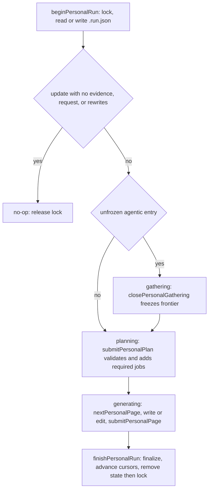

# Personal Lifecycle Core

Personal mode (the local brain under `~/.openwiki/wiki`) has the same architecture repository mode has: a **model-free lifecycle core** owns run state, the evidence a run consumes, the page-job queue, validation, and finalization, and interchangeable **drivers** own only model work. The core is `src/generation/personal-run.ts` (with `personal-run-state.ts`, `personal-run-plan.ts`, and `personal-run-lock.ts`), a sibling of the repository core described in [Repository generation](repository-generation.md). The native driver is `src/agent/personal-runner.ts`; a host coding agent is the second driver ([Personal host agent mode](../integrations/personal-host-mode.md)). A run begun by one driver can be resumed by another.

It exists because the earlier monolithic personal run could not be resumed, recorded no notion of which connector pulls were already in the wiki, allowed several processes to write the wiki at once, and kept rules the code could enforce (quickstart last, keep source pages as evidence indexes) only in a prompt.

## Opt-in and entry points

`OPENWIKI_PERSONAL_CORE=1` (`isPersonalCoreEnabled`) routes `openwiki personal --init/--update` through `runNativePersonalGeneration`; without it the legacy conversational path runs. `openwiki ingest` uses the same flag: with it, ingestion pulls first and then runs one core update (see [Personal ingestion](personal-ingestion.md)), and `--pull-only` is allowed. The CLI passes a takeover confirmation to the run (`confirmPersonalTakeover`), described below.

## Durable state

Everything lives in the wiki directory and is written atomically:

- `.run.json` is the active run's checkpoint (`kind: "personal"`, schema version 1): mode, phase (`gathering`, `planning`, `generating`), language, scope, optional instruction, actor, the evidence **frontier**, the plan with each page job's status (`pending`, `skipped`, `complete`), and the pre-run content snapshot and prepared wiki state used at finalization. Code-mode and personal readers reject each other's checkpoint.
- `.synthesis-cursor.json` records, per connector, the newest raw run already synthesized (`synthesizedThrough`), when, and by which run.
- `.run.lock` is the single-writer lock.

**Evidence is raw runs.** A connector pull writes a raw run under `~/.openwiki/connectors/<id>/raw/<rawRunId>/`. A run consumes a fixed set of them, its **frontier**: per in-scope connected connector, the raw runs newer than the cursor, or only the newest run when the connector has no cursor. A deterministic connector with nothing new contributes no entry. An agentic connector (`notion`, `custom-mcp`; `AGENTIC_PERSONAL_CONNECTORS`) always contributes an *unfrozen* entry because gathering may still add evidence. Pages cite evidence with `raw://<connector>/<rawRunId>/<file>` refs, optionally with an RFC 6901 `#/json/pointer` fragment, and a ref outside the frontier is rejected.

## Lifecycle operations

The lifecycle from begin to finish; an interrupted run keeps `.run.json` and is resumed by the next begin.

**Begin** (`beginPersonalRun`) validates the language first (an unrecognized one is `invalid_input`, since a started run's language cannot change), acquires the lock, and only then reads state. With no active run it computes the frontier and either proves an update a **no-op** (no evidence, no instruction, and no required rewrites; it records the update as complete and releases the lock) or writes `.run.json` and an `interrupted` `.last-update.json` — from that moment the run is resumable. A language change on update requires rewriting every existing page. With an active run, begin **resumes** it: a different mode or language is a `conflict`, skipped jobs return to pending, raw runs the user deleted are dropped with a warning, and a new instruction replaces the old one only while nothing was planned from it.

**Gathering** (`closePersonalGathering`) ends the phase for agentic connectors: it adds the raw runs those connectors wrote since the run began, freezes every entry, and moves the run to planning. A frozen frontier never grows.

**Plan** (`submitPersonalPlan`) accepts a plan only in `planning`, validates it (`createPersonalPlan`), adds the core's required jobs, orders the queue, and moves to `generating`. Submitting the *same* plan again is accepted; a *different* plan is `invalid_state`. A rejected plan writes nothing and the driver resubmits. The rules the code enforces:

- Paths are canonical virtual Markdown paths with no empty, dot, or hidden segment; no duplicates; a page cannot be both planned and deleted; seed evidence must lie inside the frontier; a `scope.pages` allowlist restricts the planner (the core's own jobs are exempt).
- An `init` plan cannot delete pages, and `/quickstart.md` and `/open-questions.md` can never be deleted.
- Required jobs are added by code: a `/sources/<connector>.md` evidence-index job for each frontier connector with files, an `/open-questions.md` maintenance job once that page exists and the run has evidence or a request, a rewrite job per existing page after a language change, and `/quickstart.md` for init and for an update that adds or deletes pages.
- The queue is ordered by tier then path: domain pages, then the canonical summary pages (`/commitments.md`, `/personal-logistics.md`, `/themes.md`), then source pages, then open questions, then quickstart last.

**Pages.** `nextPersonalPage` returns the first non-excluded pending job without reserving it, with its current `pageVersion` (`sha256:` of the bytes, or `absent`); a maintenance job also carries the Active section of the page and the pages changed so far. `writePersonalPage` and `editPersonalPage` are the only mutation path: each takes the `baseVersion` the content was based on, and a page changed since then (for example edited by the user) fails with `conflict` and is left unchanged, so a worker re-reads instead of overwriting. Writes repair front matter. `submitPersonalPage` requires the page to exist with repairable valid front matter, is idempotent for a completed job, and marks it complete under the run-mutation lock (`withRunMutation`, shared with the repository core). `capturePersonalPageSnapshot`, `restorePersonalPage`, and `skipPersonalPage` give drivers the same snapshot, retry, and skip semantics as repository runs; a skipped job returns to pending on resume.

**Finish** (`finishPersonalRun`) requires an accepted plan and no pending job, and requires an original snapshot for every skipped job. It applies planned deletions, finalizes the wiki artifacts (indexes, provenance, OKF validation) with the page producers, restores skipped pages from their snapshots, advances synthesis cursors, writes `.last-update.json` (`interrupted` if any job was skipped, else `complete`), and removes `.run.json` then the lock **last**, so a crash at any step leaves a run the next begin resumes and finishes again. A connector's cursor advances to its newest frontier raw run only if every job seeded with its evidence completed; otherwise it is **held**, so that evidence is read again by the next run. Evidence is never silently dropped.

## Single-writer lock

At most one process mutates the personal wiki through the core. `.run.lock` records the holder (`<driver>:<hostname>:<pid>`, for example `native:` or `host-claude:`), the run id, and acquire and renew times. Rules:

- The lock is acquired before any state is read; every failure after that releases it again while keeping durable run state.
- A fresh lock held by another holder is a `conflict` that names the holder and how long ago it was active (`PersonalRunLockConflictError`).
- A lock is **expired** when not renewed for 30 minutes, or immediately when its holder ran on this machine and that pid is gone. An expired lock is taken over only with an explicit `takeover`; the old lock is moved aside and the new one created exclusively, so of two simultaneous takers exactly one wins.
- Every core operation after begin renews the lock and fails with `conflict` if this process no longer holds it. A driver that exits without finishing releases the lock and leaves `.run.json`.
- Takeover is a user decision: the CLI asks `[y/N]` on a terminal (`createTerminalTakeoverConfirmation`), a host agent passes `takeover: true` only after the user confirms, and scheduled ingestion never takes over.

## The native driver

`runNativePersonalGeneration` begins (retrying once with `takeover` if the lock is expired and the user confirms), emits `repository_progress` events with `wiki: "personal"` for the `gathering`, `planning`, and `finalizing` stages, and renews the lock on a timer (default every 5 minutes, well inside the 30-minute expiry) while workers run. It then runs, in order:

1. a **gather worker** when the phase is `gathering`: a read-only agent with the gather tools for the open agentic connectors; if it ends without calling `close_gathering` the driver closes gathering for it, and a failed worker leaves the run in gathering to be resumed;
2. a **planner** when the phase is `planning`: a read-only agent that must call `submit_plan` (rejected plans come back as correctable tool messages); when there is no evidence and no request the driver submits an empty plan and starts no planner;
3. **page workers** through the shared pool in `src/agent/page-workers.ts` — the same `runPageWorkers`, retry-then-skip loop, and rate-limit handling the repository runner uses ([Agent runtime](../architecture/agent-runtime.md)), with `/quickstart.md` held back to a final single-worker pass; and
4. `finishPersonalRun` with the skipped-page snapshots, reporting any connector whose cursor was held.

No worker has a shell, ingest tools, or delegation (`NO_DELEGATION_MIDDLEWARE`). Each page worker's backend (`PersonalPageWorkerBackend`) allows writes only to its own page and routes them through the core's page change check, taking the base version from job start, the worker's last write, or its last complete read. Raw evidence reaches workers only through read-only raw-evidence tools. On any failure the driver releases the lock and keeps `.run.json`, so the next begin from any driver resumes the run. Personal Claims (grounded, versioned facts) are not part of this lifecycle; connector-derived facts are synthesized under confidence labels instead, as described in [Personal ingestion](personal-ingestion.md).

## Where to look

- Core: `src/generation/personal-run.ts`, `personal-run-state.ts`, `personal-run-plan.ts`, `personal-run-lock.ts`, and shared helpers in `src/generation/shared/`.
- Driver and workers: `src/agent/personal-runner.ts`, `personal-worker-tools.ts`, `personal-prompts.ts`, `prompts/personal-guidance.ts`.
- Spec: `specs/personal-lifecycle-core.md` (conformance ids PLC-001 to PLC-019).
- Tests: `test/generation/personal-run.test.ts`, `personal-run-plan.test.ts`, `personal-run-boundary.test.ts`, `test/agent/personal-runner.test.ts`.
